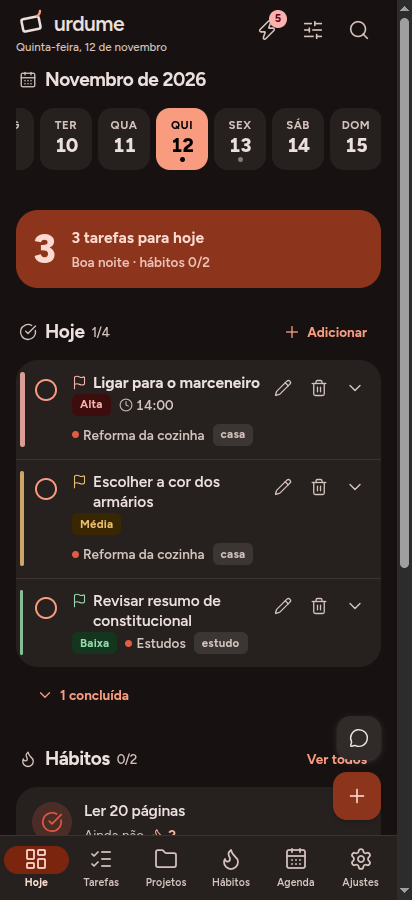
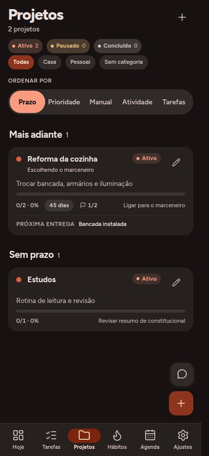
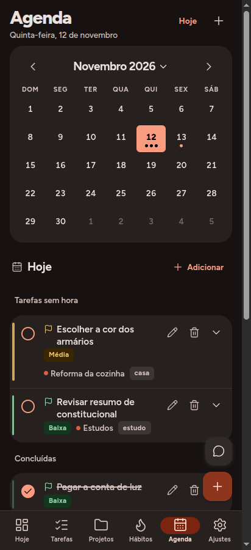
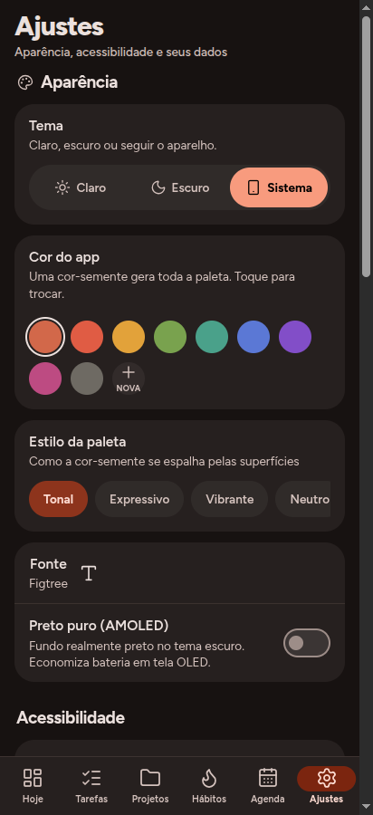
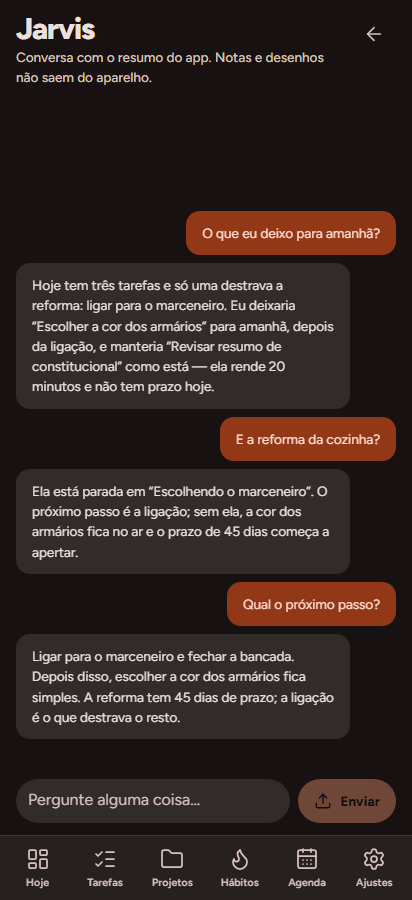
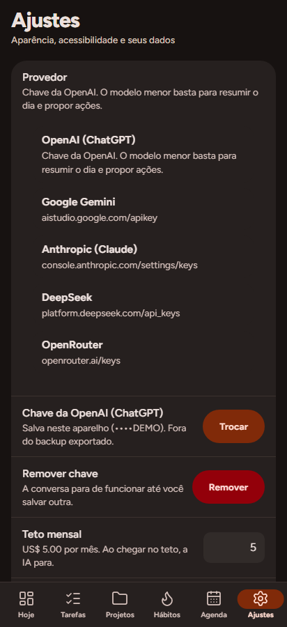

<div align="center">
  
  <h1>Urdume Público</h1>
  <p><strong>Your day, on your device.</strong><br />
  Tasks, projects, habits and calendar with an AI assistant that runs on your own API key.</p>

  <p>
    
    
    
    
    
    
  </p>

  <sub><strong>English</strong> · <a href="README.pt-BR.md">Português</a></sub>
</div>

> [!NOTE]
> The app interface and the in-depth documentation are written in Portuguese (pt-BR).
> This page describes the project in English; the code and the architecture are
> language-neutral.

> [!WARNING]
> **Beta.** The app works and has 295 automated tests, but it has not seen
> prolonged use on many devices. Expect defects. Read
> [known limits](docs/LIMITES.md) (Portuguese) before entrusting it with your
> data, and export a backup from time to time.

---

## Why this exists

Many productivity apps ask for an account, keep your data on a server you cannot
see, and add an AI assistant that bills you through a proxy. Urdume Público takes
the opposite route:

- **Local-first.** The database is IndexedDB inside the app. No account, no
  login, no cloud, no author server.
- **Your key, your bill.** There is no embedded API key and no proxy. Requests
  go from your device straight to the provider you choose.
- **Android and web.** The same React app ships as an APK through Capacitor and
  runs as a PWA in the browser.
- **Small and legible.** React 19, TypeScript, Vite and Dexie. No UI framework,
  no analytics SDK, no telemetry.

## Screenshots

<table>
  <tr>
    <td align="center"><br /><sub>Today</sub></td>
    <td align="center"><br /><sub>Tasks</sub></td>
    <td align="center"><br /><sub>Projects</sub></td>
  </tr>
  <tr>
    <td align="center"><br /><sub>Calendar</sub></td>
    <td align="center"><br /><sub>Habits</sub></td>
    <td align="center"><br /><sub>Settings</sub></td>
  </tr>
</table>

<sub>Screenshots from the Android build, in Portuguese.</sub>

## What it does

| Area | What you get |
|---|---|
| **Tasks** | Scheduled day, separate deadline, time, duration, priority, tags and subtasks. "I will do this on Thursday" and "I must deliver this on Friday" are different fields, not free text. |
| **Projects** | Free-form category, its own priority (separate from manual order), deadline, milestones and dated notes. Five sorting criteria. |
| **Habits** | Weekday schedule, goal, streak and heatmap. |
| **Calendar** | Month view, selectable day and timed events. |
| **Reminders** | Local notifications at the set time, even with the app closed. |
| **Jarvis** | Reads your day, points out what is stuck and **proposes** actions: create a task, check a habit, add a note to a project. Nothing runs without confirmation, and every action can be undone. |
| **Data** | Local IndexedDB database, JSON backup export and import, no account. |

### The assistant

Jarvis is not a chat window bolted onto a to-do list. It reads the actual state
of your day — tasks, deadlines, projects, habits — and turns it into a short
briefing with suggested actions. Each proposal is a structured object that you
accept or reject; the model never writes to the database directly.

There are silent, manual and paused modes, plus a local monthly spending cap
based on a price table in the code. The cap is a local guard, not a guarantee
about your provider invoice.

<p align="center">
  
  
  <br />
  <sub>The real screens: conversation, and Settings → Jarvis (provider, key hint
  and monthly cap). Sample tasks and an example key — no live provider call in
  this capture.</sub>
</p>

<p align="center">
  
  <br />
  <sub>Project detail: progress, milestones, tasks and dated notes.</sub>
</p>

## What it does not do

Stated up front so nobody expects the wrong thing:

| Not included | Why |
|---|---|
| Account, login, cloud | The database is local. There is no server. |
| Sync between devices | Not part of this public variant; each device is independent. |
| Drawing board | Removed for licensing: tldraw has its own terms. |
| AI without your key | No embedded key and no proxy; you pay your provider directly. |
| iOS version | Android and the browser only. |
| Home-screen widget | Not implemented. |
| Automatic backup | Android backup is disabled on purpose, so only the export you make exists. |
| Encryption at rest | None; the API key is stored in plaintext. Device lock is the real protection. |
| Reliable AI in the browser | Providers often block cross-origin calls (CORS). Use the APK. |
| A desktop layout | Designed for phones; on a desktop it shows a narrow column. |
| A screen-reader audit | Labels and focus exist, but TalkBack has not been audited. |

The full list, including notification delays and migration caveats, is in
[docs/LIMITES.md](docs/LIMITES.md) (Portuguese).

## Privacy, in plain words

- **No telemetry.** No analytics, no crash reporting, no author server. The app
  contacts no third-party service unless you ask the assistant.
- **What leaves the device:** a summary of your day (task titles, deadlines,
  project names) and the conversation text. Free-form notes and the rest of the
  database stay on the device.
- **What stays:** everything else, in IndexedDB. The backup is a JSON file you
  export and store wherever you want. Importing a backup replaces the whole
  database.
- **The API key** lives only on the device, in a table excluded from exported
  backups. It is not encrypted: anyone with the unlocked phone can read it.
- **No account means no recovery.** A lost phone without a backup is lost data.

## Quick start

### 1. Install the APK (Android 7.0+)

Download `urdume-publico-0.1.0-beta.1.apk` from
[Releases](https://github.com/ReiThomato/urdume-publico/releases/latest) and
open it on the phone. Android will ask permission to install from an unknown
source. The release page publishes the SHA-256 checksum of the file.

The APK is also tracked in [`dist-apk/`](dist-apk/) in this repository.

### 2. Run it in the browser

Requirements: Node 20+.

```bash
cd app
npm install
npm run dev
```

It opens at `http://localhost:5173` and works offline after the first load. AI
calls may be blocked by CORS in the browser; the app tells you when that
happens. For the full assistant, use the APK.

### 3. Build the APK yourself

Requirements: Node 20+, JDK 17+ and the Android SDK.

```bash
cd app
npm install
npm run build
npx cap sync android
cd android && ./gradlew assembleDebug
```

The APK is written to `app/android/app/build/outputs/apk/debug/app-debug.apk`.

### 4. Connect the AI

You need a key from a provider. The app does **not** ship one.

1. Open **Settings → Jarvis**.
2. Pick a provider.
3. Tap **Add** and paste the key.
4. Go back to Jarvis.

| Provider | Where to get a key | Default model |
|---|---|---|
| OpenAI | [platform.openai.com/api-keys](https://platform.openai.com/api-keys) | `gpt-4o-mini` |
| Google Gemini | [aistudio.google.com/apikey](https://aistudio.google.com/apikey) | `gemini-2.0-flash` |
| Anthropic | [console.anthropic.com/settings/keys](https://console.anthropic.com/settings/keys) | `claude-3-5-haiku-latest` |
| DeepSeek | [platform.deepseek.com/api_keys](https://platform.deepseek.com/api_keys) | `deepseek-chat` |
| OpenRouter | [openrouter.ai/keys](https://openrouter.ai/keys) | `anthropic/claude-3.5-haiku` |

## How the assistant talks to providers

One module (`app/src/lib/jarvis/provedores.ts`) holds the three dialects. They
are **not** compatible with each other, and that is the part that usually
breaks:

| | OpenAI and compatible | Gemini | Anthropic |
|---|---|---|---|
| Endpoint | `/v1/chat/completions` | `/<model>:generateContent` | `/v1/messages` |
| Authentication | `Authorization: Bearer` | `x-goog-api-key` | `x-api-key` + version |
| System instruction | `messages[0]` | `systemInstruction` | `system` |
| Response | `choices[0].message.content` | `candidates[0].content.parts[]` | `content[]` |

Adding a provider that speaks the OpenAI format is one entry in `PROVEDORES`
with `dialeto: 'openai'`. The test `provedores.test.ts` checks that every
declared provider can build a request body and read a response.

There is no proxy, gateway or author address in the path: the request leaves
your device and goes straight to the provider, with your key.

## How it is built

```
WebView (APK) / browser
  screens/  ──►  db/repo.ts  ──►  Dexie (IndexedDB)
     │              ▲
     ▼              │
  ui/  ◄────────────┘  (reactive useLiveQuery)

  lib/jarvis/ ──► AI provider (HTTP, your key)
     │
     └──► local notifications (Android)
```

No server. No account. The only network egress is the AI provider call.

```
app/src/
  app/        router, theme, Today blocks
  db/         Dexie schema, repository, migrations
  lib/
    jarvis/   assistant: signals, relevance, executor, autonomy, providers
    date.ts   local dates (the app counts the day in the device timezone)
  screens/    one screen per route
  ui/         shared components
  styles/     plain CSS per area, no framework
app/android/  Capacitor project
docs/         documentation beyond this README
```

The code comments and documentation are in Portuguese, following the same
conventions described in [docs/CONTRIBUINDO.md](docs/CONTRIBUINDO.md).

## Tests

```bash
cd app
npm ci
npm test        # 295 tests
npx tsc -b      # type check
```

28 test files cover the database, migrations, data merging, assistant signals,
the three provider dialects and APK hygiene. Automated tests cover logic, not
the behavior of Android on every manufacturer — see the beta warning above.

## Documentation

The complete manual is in Portuguese:

| Document | What it covers |
|---|---|
| [Arquitetura](docs/ARQUITETURA.md) | layers, data model, assistant pipeline and design decisions |
| [Limites e falhas conhecidas](docs/LIMITES.md) | what does not exist, what is not guaranteed, what was actually tested |
| [Contribuindo](docs/CONTRIBUINDO.md) | code and test conventions, and what does not get merged |
| [Licença](LICENSE) | the full license text |

## License

**Source-available, not OSI open source.** Urdume Público is distributed under
the [PolyForm Noncommercial 1.0.0](LICENSE).

You may use, study, modify and share it for personal use, study, research or
nonprofit projects. You may not sell it, charge for it or use it to generate
revenue. Commercial use requires an agreement with the author. The binding text
is [LICENSE](LICENSE).

## Origins and credits

This is a derivative of a personal app, published as a source-available variant.
Two things from the original are **not** here, by licensing and privacy
decisions:

- **the drawing board** (tldraw), which has its own license and cannot be
  redistributed this way;
- **sync with a personal server**, which depended on the author's
  infrastructure.

What remains is the core: routine, projects and the assistant. It was rewritten
to accept a key from any provider, with its own app and database identity so it
does not conflict with the original on the same device.

Built with React, Vite, Capacitor, Dexie, Lucide and Material Color Utilities.
Android is a trademark of Google LLC. AI provider names are trademarks of their
respective owners. No affiliation with any of them.
