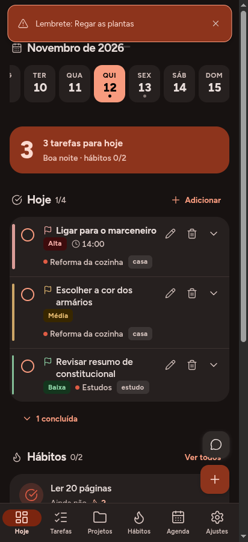
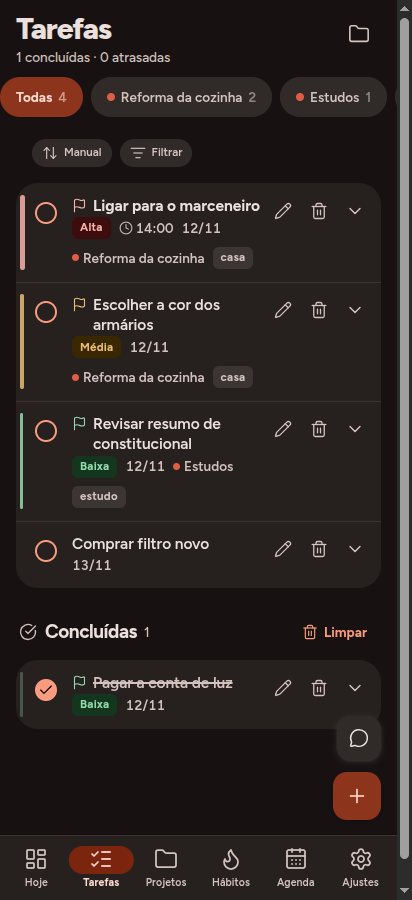
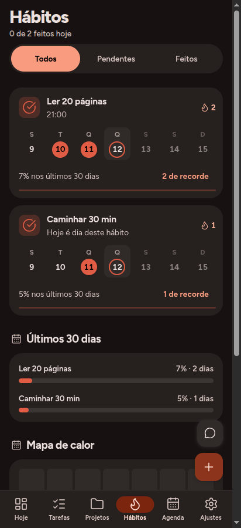
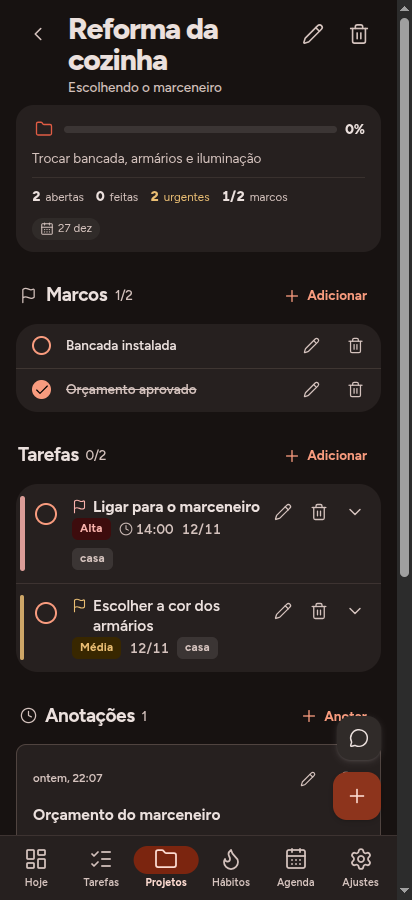

# Urdume Público

Um app de rotina — tarefas, projetos, hábitos e agenda — com um assistente de
IA que roda **na sua chave**. Sem conta, sem servidor do autor, sem telemetria.

| Hoje | Tarefas | Projetos |
| --- | --- | --- |
|  |  |  |

| Agenda | Hábitos | Jarvis |
| --- | --- | --- |
|  |  |  |

> ## ⚠️ Beta
>
> Este app está em **beta**. Funciona, tem 295 testes automatizados, mas não
> passou por uso prolongado em muitos aparelhos. Espere encontrar defeitos.
> Leia [Limites e falhas conhecidas](docs/LIMITES.md) antes de confiar seus dados
> a ele — e exporte um backup de vez em quando.

---

## O que ele faz

**Tarefas** com dia marcado, prazo separado, hora, duração, prioridade,
etiquetas e subtarefas. A distinção entre "vou fazer quinta" e "tenho que
entregar sexta" é do modelo, não um campo de texto.

**Projetos** com categoria livre, prioridade própria (separada da ordem
manual), prazo, marcos e anotações datadas. Cinco critérios de ordenação.

**Hábitos** com dias da semana, meta, sequência e mapa de calor.

**Agenda** com mês, dia selecionável e eventos com duração.

**Lembretes** que disparam notificação no horário, mesmo com o app fechado.

**Jarvis** — o assistente. Ele lê o seu dia, aponta o que está travando e
**propõe** ações (criar tarefa, marcar hábito, anotar num projeto). Nada é
executado sem a sua confirmação, e cada ação pode ser desfeita.



---

## Começando em 10 minutos

### 1. Rodar no navegador (o mais rápido)

```bash
npm install
npm run dev
```

Abre em `http://localhost:5173`. Funciona offline depois do primeiro carregamento.

**Limite:** no navegador, a análise por IA pode ser barrada por CORS, porque o
provedor não permite chamada de outra origem. O app avisa quando acontece. Para
a IA funcionar de verdade, use o APK.

### 2. Gerar o APK

Pré-requisitos: Node 20+, JDK 17 e Android SDK.

```bash
npm install
npm run build
npx cap sync android
cd android && ./gradlew assembleDebug
```

O APK sai em `android/app/build/outputs/apk/debug/app-debug.apk`.

### 3. Ligar a IA

Precisa de uma chave de um provedor. O app **não** traz chave embutida.

1. **Ajustes → Jarvis**
2. Escolha o provedor (OpenAI, Gemini, Claude, DeepSeek ou OpenRouter)
3. Toque em **Adicionar** e cole a chave
4. Volte ao Jarvis

| Provedor | Onde pegar a chave | Modelo padrão |
| --- | --- | --- |
| OpenAI | platform.openai.com/api-keys | `gpt-4o-mini` |
| Google Gemini | aistudio.google.com/apikey | `gemini-2.0-flash` |
| Anthropic | console.anthropic.com/settings/keys | `claude-3-5-haiku-latest` |
| DeepSeek | platform.deepseek.com/api_keys | `deepseek-chat` |
| OpenRouter | openrouter.ai/keys | `anthropic/claude-3.5-haiku` |

A chave fica **só neste aparelho**, numa tabela fora do backup exportado. Quem
tiver o celular desbloqueado consegue lê-la; por isso o bloqueio de tela importa.

---

## Como a IA é chamada

Um único módulo (`src/lib/jarvis/provedores.ts`) concentra os três dialetos.
Eles **não** são compatíveis entre si, e essa é a parte que costuma quebrar:

| | OpenAI e compatíveis | Gemini | Anthropic |
| --- | --- | --- | --- |
| Endpoint | `/v1/chat/completions` | `/<modelo>:generateContent` | `/v1/messages` |
| Autenticação | `Authorization: Bearer` | `x-goog-api-key` | `x-api-key` + versão |
| Instrução de sistema | `messages[0]` | `systemInstruction` | `system` |
| Resposta | `choices[0].message.content` | `candidates[0].content.parts[]` | `content[]` |

**Adicionar um provedor** que fale o formato da OpenAI é uma entrada em
`PROVEDORES`, com `dialeto: 'openai'`. O teste `provedores.test.ts` confere que
todo provedor declarado sabe montar corpo e ler resposta.

Não há proxy, gateway nem endereço do autor no caminho: a requisição sai do seu
aparelho direto para o provedor, com a sua chave.

---

## O que a IA pode e não pode

**Pode propor:** criar tarefa, projeto, marco, evento, lembrete, hábito; marcar
hábito; anotar em projeto; organizar projeto (categoria e prioridade); avisar.

**Nunca executa sem confirmação** e nunca apaga, altera backup, muda
configuração ou o nível de autonomia. Existe modo silencioso, manual e pausado.

**Privacidade:** o que vai para o provedor é um resumo do seu dia — títulos de
tarefas e nomes de projetos —, não o banco inteiro. O texto da conversa e as
anotações livres ficam no aparelho.

---

## Estrutura

```
src/
  app/        roteador, tema, blocos do Início
  db/         Dexie (IndexedDB): schema, repositório, migrações
  lib/
    jarvis/   o assistente: sinais, relevância, executor, autonomia, provedores
    date.ts   datas locais (o app conta o dia pelo fuso do aparelho)
  screens/    uma tela por rota
  ui/         componentes compartilhados
  styles/     CSS por área, sem framework
android/      projeto Capacitor
docs/         documentação além deste README
```

O banco é local: IndexedDB dentro do WebView. Não há conta, login nem nuvem.
**Faça backup** em Ajustes → Seus dados → Exportar.

---

## Documentação

- [Arquitetura](docs/ARQUITETURA.md) — como as peças conversam
- [Limites e falhas conhecidas](docs/LIMITES.md) — leia antes de confiar
- [Contribuindo](docs/CONTRIBUINDO.md) — padrões de código e de teste
- [Licença](LICENSE) — PolyForm Noncommercial 1.0.0

---

## Licença, em uma frase

Você pode usar, estudar, modificar e compartilhar — **para uso próprio, estudo,
pesquisa ou projetos sem fins lucrativos**. Não pode vender, cobrar por ele nem
usar para gerar receita. O texto que vale é o de [LICENSE](LICENSE).

Se você quer usar comercialmente, é preciso falar com o autor.

---

## De onde isto veio

Este é um derivado de um app pessoal, publicado como variante de código aberto.
A versão original tinha duas coisas que **não** estão aqui, por decisão de
licenciamento e de privacidade:

- **o quadro de desenho** (tldraw), que tem licença própria e não pode ser
  redistribuído assim;
- **a sincronização com um servidor pessoal**, que dependia da infraestrutura do
  autor.

O que ficou é o núcleo: rotina, projetos e o assistente. Ele foi reescrito para
receber a chave de qualquer provedor, com identidade própria de aplicativo e de
banco, para não conflitar com o original no mesmo aparelho.
